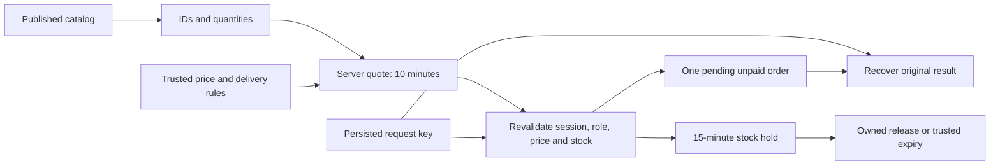

# Phase 3.2–3.3 — cart, pricing and pending reservations

4 November 2026 · `Sai-Branch` · local acceptance only.

This is the 3.2–3.3 checkpoint; the later [payment increment](commerce-payments.md)
supersedes the progress/next-step statements below. Current Phase 3 is 5/8 local,
0/8 hosted.
This extends [catalog/product approval](commerce-catalog.md). Phase 3 has **3/8
local criteria complete, 0/8 hosted**. Earlier phase exit gates remain open.
No hosted commerce migration, frontend publishing, paid resource, payment,
refund, courier or outbound provider action occurred.

## Delivered behavior

Customers can add a published, non-prescription product to a cart, edit quantities,
check availability, enter delivery details, review a server quote and reserve
stock for a pending **unpaid** order. They can recover an uncertain request, reload
its result, view their own reservation history and release an unpaid reservation.
Payment is explicitly unavailable. Reservation success never means payment success.

The main application routes `/shop`, `/shop/:id`, `/cart`, `/checkout` and
`/checkout/orders` remain behind the existing functional preview boundary.
Local review is `npm run preview:commerce` → `http://127.0.0.1:4184/shop` with
clearly fictional products, sample delivery rules and a fictional buyer. That
adapter is never imported by production routes. The temporary review server was
stopped after QA; the pre-existing local Supabase stack was left running.

All 17 account roles may shop as themselves using a current assigned workspace.
An account with multiple grants must explicitly choose a workspace. An ungranted
URL role is denied before data screens mount. Administrative order operations
remain a separate capability; this customer API returns only the caller’s orders,
even when the caller selects an administrator workspace.

## Module boundaries

| Module | Responsibility |
| --- | --- |
| `checkoutModel.ts` | Strict cart/address/quote/receipt contracts; exact integer paise; safe errors |
| `checkoutCart.ts` | Persist only product IDs and quantities; bounded quantities/unique lines; conservative legacy cart migration |
| `checkoutIntent.ts` | User/workspace-scoped pending quote ID + request key; no persisted address, price or payment credentials |
| `checkoutGateway.ts` | Narrow action transport, cancellation on reads, response validation and request/result identity checks |
| `checkoutService.ts` | Candidate Supabase RPC adapter, separate from generated live-schema types |
| `CheckoutRoutes.tsx` | Existing account/role guard, multi-role chooser and identity/revision remount boundary |
| `CheckoutUI.tsx` / `checkout.css` | Cart, delivery/quote review, reservation recovery/detail and bounded history; readable responsive UI |
| `phase3-checkout.sql` | Private pricing policy/coupons/quotes/stock holds/audit plus narrow caller-scoped API |
| `checkout-permissions.test.mjs` | Recreated metadata/migrations + adversarial PostgreSQL contract tests |
| `checkout-local.mjs` | Existing loopback Auth/PostgREST/PostgreSQL integration and actual concurrent lock waits |

## Pricing and stock contract

- The browser sends IDs, integer quantities, postcode and optional coupon code.
  Prices, totals, user ID, paid state and fulfilment state are rejected as request
  fields. Runtime response checks reject inconsistent amounts or substituted IDs.
- Amounts use integer paise, with a supported cart total of ₹0.01–₹1 crore.
  Product price is bounded to ₹10 lakh per unit. Carts contain 1–20 unique products,
  each with quantity 1–99. Unsupported zero-total orders are rejected.
- Trusted policy supports INR, explicitly tax-inclusive prices, configured delivery
  prefixes, delivery charges and an optional free-shipping threshold after discounts.
  It does not invent tax rates, coverage, shipping thresholds or legal policy.
- Coupons support percentage basis points, fixed discounts or free shipping,
  validity windows, minimum subtotal, percentage caps, customer binding and global/
  per-customer allocation limits. Percentage arithmetic rounds half up to paise.
- Quotes expire after ten minutes and contain immutable pricing/product revision
  snapshots. Reserve rechecks the exact snapshot and postcode. Changed prices or
  rules require a new review. Prescription products fail closed pending a separate
  approved prescription workflow.
- Product locks are acquired in stable UUID order. Availability is read in a fresh
  statement after lock waits, accounting for active stock holds. Coupon validity
  is also checked after waiting. A 5-second lock timeout produces a recoverable
  failure rather than an assumed order result.
- Holds last fifteen minutes. Expired holds stop consuming availability immediately,
  even before the trusted expiry worker marks their pending orders cancelled.
  No scheduler was created. Service-only expiry is bounded and uses SKIP LOCKED.
- Public catalog “in stock” currently describes on-hand stock. Checkout checks
  reservation-adjusted availability. It must not be interpreted as a stock promise.

**Production rules remain unapproved.** The policy defaults to disabled, with no
shipping/tax rules. Synthetic test settings are not business decisions; native
verification restores `enabled=false`. Reward redemption and saved-address
workflows are deferred, not approved for deletion; optional feature decisions
remain in [the feature inventory](feature-scope-review.md). The earlier cart and
checkout snapshots are retained in the canonical handover work directory.

## Request recovery and permissions

The browser must persist a random request key before sending reserve. If storage
is unavailable, or the previous reference cannot be read, it cannot start a new
attempt. Only quote ID + request key are stored in session storage. Quote results
are discarded when cart/delivery/coupon input changes, including a late response
from an earlier request.

Reserve locks the real user/request identity and consumes each quote at most once.
An exact retry returns the original order even after quote expiry. A different
payload/key cannot silently reuse that order. The recover action waits on the same
lock before deciding whether an order exists, then returns only the owner’s
receipt or original quote. An unknown network outcome retains the key. An expired
quote with a server-confirmed absent order permits a fresh quote.

Private checkout tables have RLS and no browser grants/policies. The public
function is SECURITY INVOKER; its private, fixed-search-path implementation checks
current database role grants and a real, confirmed Auth user with a live
`auth.sessions` identity. Reserve repeats access checks after stock-lock waits.
Editable user metadata provides no authority. The earlier catalog candidate fences
legacy direct order writes, including retained column-level write grants.

Order creation, stock/coupon allocation and audit commit together. Audit failure
rolls back all three. The expiry worker is service-only. Release is limited to the
owner’s unpaid pending hold and never calls a refund provider.

## Verified evidence

- Full unit suite: **277 tests / 24 files**, including **64 commerce tests**.
  Covers all 17 UI role workspaces, ungranted roles, failed identity checks,
  blocked/malformed persistence, price tampering, late/expired quotes, lost-response
  reload recovery, same-key retry, prescription blocking, release and owned history.
- PostgreSQL candidates: **22 checkout scenarios** plus **16 catalog scenarios**;
  **40 Node tests including two parent suites**. Tests use inspected products/orders
  metadata and the three exact earlier access migrations. Cases include every
  canonical role, removed grants, private ACLs, forged totals/paid states, wrong
  owners, coupon allocation/release, revised prices/rules, session revocation and
  audit rollback. PGlite Auth sessions are explicit synthetic fixtures.
- Native local stack: **12 scenarios** with real local Auth JWTs, PostgREST and
  PostgreSQL. Two requests genuinely waited on a separately held product lock;
  exactly one reserved the last item. Additional checks cover coupon expiration
  and role revocation during lock waits, signed-out JWT denial, direct REST forgery,
  recovery, owner history, release and service expiry. Synthetic Auth accounts, dependent orders/quotes/holds and products were
  cleaned; address-free audit events remain in the local audit trail. See [native result](../release/checkout-local-result.json).
- Scoped strict commerce TypeScript and focused lint pass. Production Vite build
  passes with the existing large-chunk warning. The inherited whole-application
  schema/type and dependency findings remain open; scoped checks do not close them.
- Local browser: catalog → cart → coupon quote → unpaid reservation → reload
  recovery → release → history/detail → fresh order. At 390px the document width
  is 390px. Mobile quote axe reports **29 passes, zero violations/incomplete**.
  See [browser evidence](../release/checkout-browser-result.json) and screenshots.

Native staging was updated through verified function-only forward changes. Each
update checked the old fixture fingerprint, deployed function body, unchanged
surrounding SQL and an empty/disabled fixture. No schema reset or migration replay
occurred. The three earlier hosted migrations remain unchanged.

## Still open

Payment initiation/verification, signed provider event ingestion, reconciliation,
fulfilment/courier operations, paid cancellations/refunds and representative
capacity acceptance remain Phase 3.4–3.8. This increment’s recovery handles an
unpaid reservation request, **not payment reconciliation**. Real pricing/delivery
rules, hosted trigger/RPC/grant preflight, rollback preparation, deployment and
real role acceptance are required before commerce is released. The inspected
legacy live commerce permissions remain unresolved until a separately reviewed,
authorized hosted repair. No production readiness or capacity claim is made.
